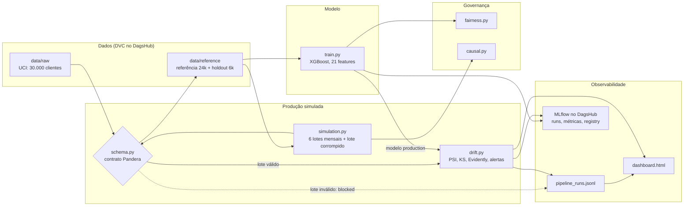
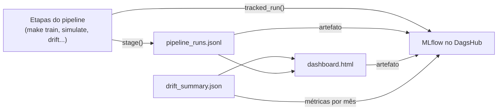
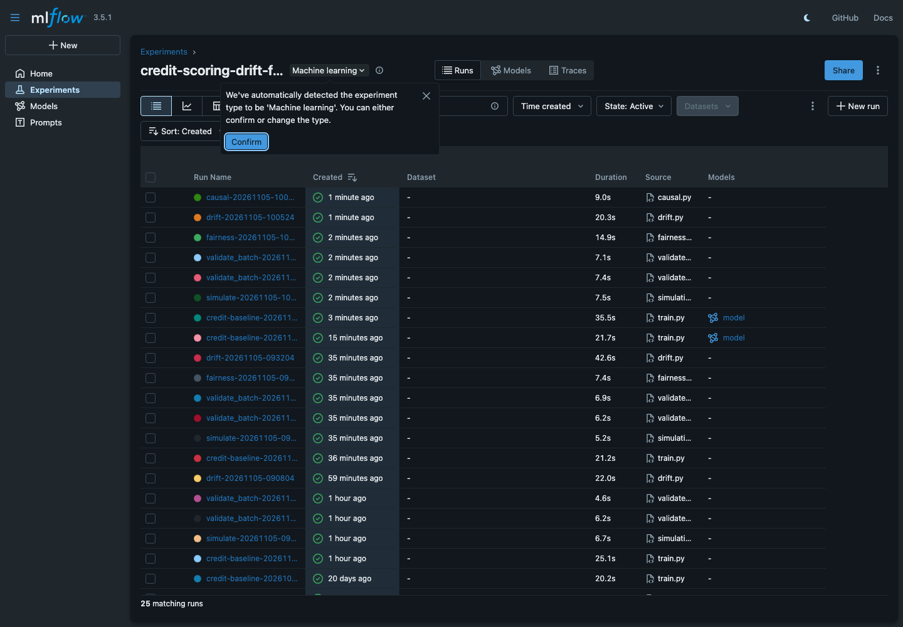
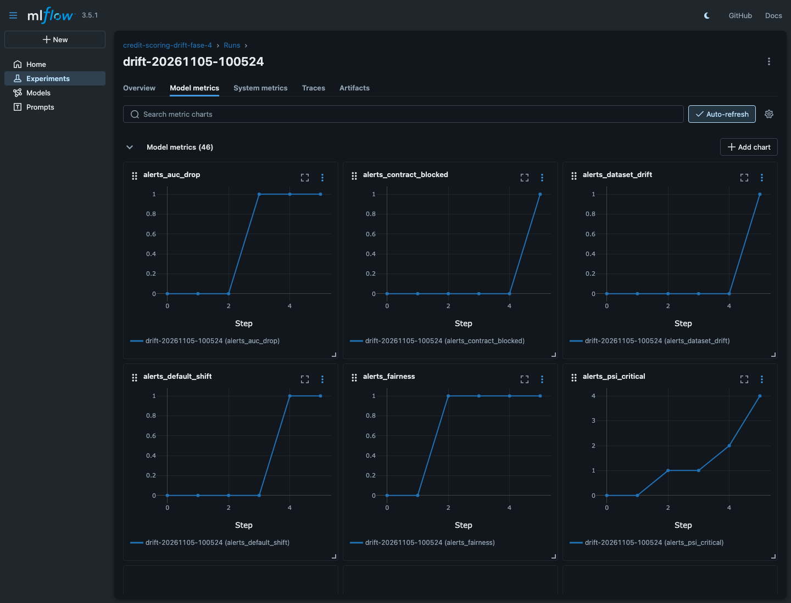
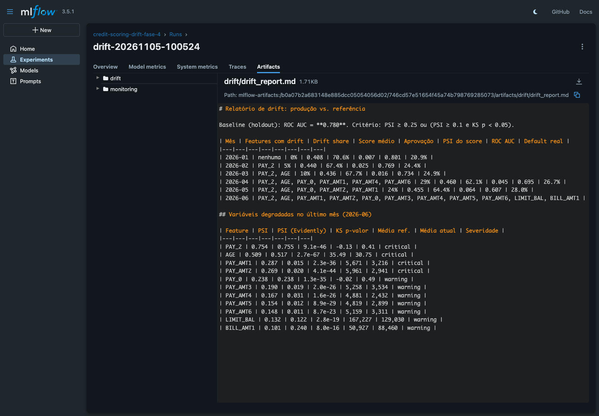
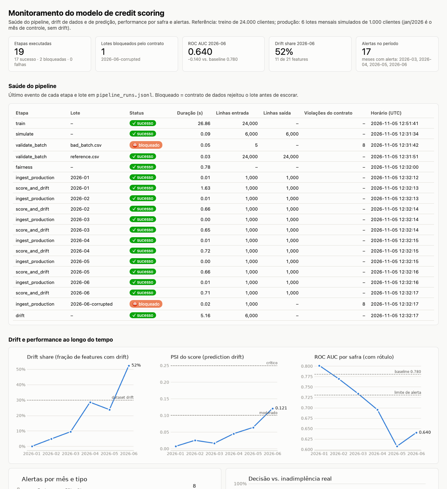
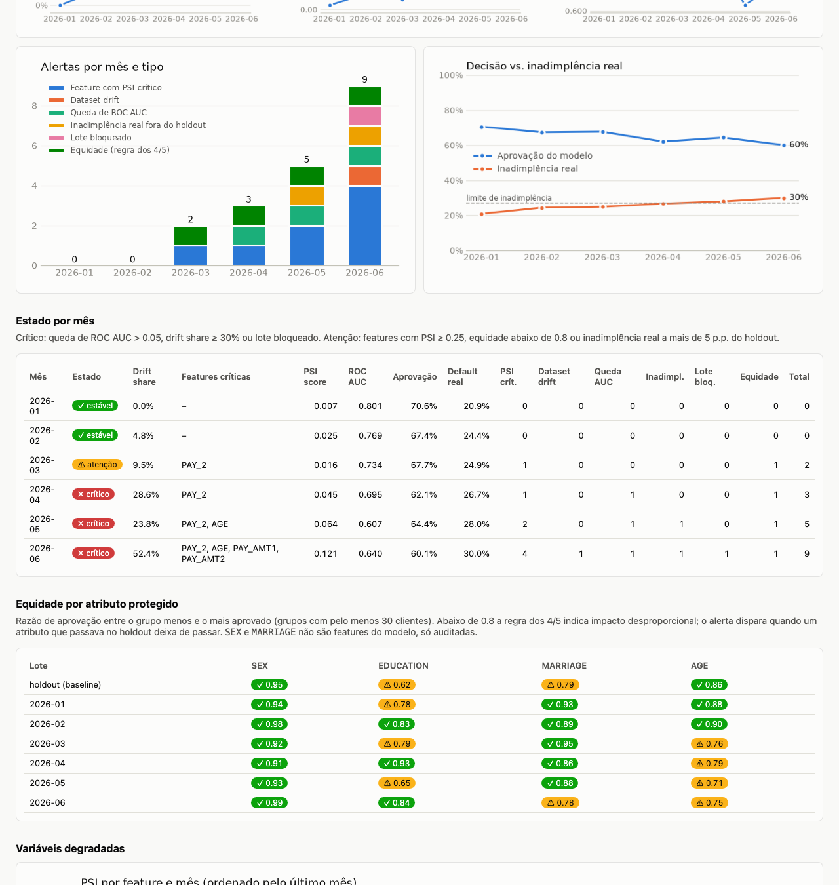
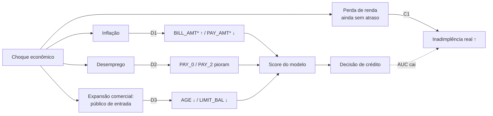

# Monitoramento de Credit Scoring: drift, contratos de dados e governança

Projeto do Tech Challenge Fase 4 (FIAP MLET). Uma fintech tem um modelo de risco de crédito em
produção; a economia muda (inflação, desemprego, novos perfis de clientes) e o modelo degrada **em
silêncio**. Este repositório constrói a camada de sustentação e confiabilidade em volta de um
baseline XGBoost: contrato de dados que bloqueia lote inválido, simulação de seis meses de produção
com data drift e concept drift, detecção estatística (PSI, KS e Evidently AI), observabilidade do
pipeline (logs estruturados, MLflow e dashboard), análise causal da degradação e plano de proteção
de dados (LGPD).

**Achado central:** o concept drift simulado responde por 74% da queda de ROC AUC (0,780 para 0,640
em jun/2026) com drift share 0%. Um monitor só de distribuição não vê a degradação; o alerta de
performance por safra vê.



---

## Links

| O quê | Onde |
|---|---|
| Vídeo STAR (até 5 min) | https://youtu.be/P7eaD5AvT9A |
| MLflow (runs, métricas, Model Registry) | https://dagshub.com/JosueJNLui/fiap-mlet-challenge-fase-4.mlflow |
| Repositório no DagsHub (DVC) | https://dagshub.com/JosueJNLui/fiap-mlet-challenge-fase-4 |
| Dataset | [UCI: Default of Credit Card Clients](https://archive.ics.uci.edu/dataset/350/default+of+credit+card+clients) |
| Dashboard de monitoramento | [`reports/monitoring/dashboard.html`](reports/monitoring/dashboard.html) (baixe e abra no navegador; funciona offline) |
| Relatório de drift | [`reports/drift/drift_report.md`](reports/drift/drift_report.md), HTMLs do Evidently em [`reports/drift/`](reports/drift/) |
| Relatórios de equidade e causal | [`reports/fairness/fairness_report.md`](reports/fairness/fairness_report.md), [`reports/causal/causal_report.md`](reports/causal/causal_report.md) |
| Evidências visuais | [`docs/img/`](docs/img/): 2 prints do dashboard e 3 do MLflow |

---

## Mapeamento dos critérios de avaliação

| Critério | Peso | Onde está |
|---|---|---|
| Validação de dados | 25% | [seção 3](#3-contrato-de-dados-e-baseline), `src/creditmon/schema.py`, `make demo-contract`, lote `2026-06-corrupted` bloqueado em `make drift` |
| Detecção de drift | 25% | [seção 4](#4-simulação-e-detecção-de-drift), `reports/drift/drift_report.md`, `reports/drift/evidently_2026-06.html` |
| Observabilidade e logs | 20% | [seção 5](#5-observabilidade), `reports/monitoring/dashboard.html`, `reports/monitoring/pipeline_runs.jsonl`, runs no MLflow ([seção 10](#10-mlflow--dagshub-model-registry)) |
| Governança (LGPD) | 15% | [seção 7](#7-governança-e-lgpd) (privacidade, base legal, retenção, vieses), [seção 6](#6-análise-causal-da-degradação) (causalidade), `reports/fairness/` |
| Vídeo STAR | 15% | [seção 11](#11-vídeo-star) |

---

## 1. Visão geral

**Dataset:** [UCI Default of Credit Card Clients](https://archive.ics.uci.edu/dataset/350/default+of+credit+card+clients),
30.000 clientes de cartão de crédito de Taiwan (2005), 25 colunas e alvo binário
`default payment next month` (22% de inadimplência). Os dados crus e a referência congelada são
versionados com DVC no DagsHub.

**Modelo:** XGBoost treinado na **referência** (24.000 clientes) e avaliado no **holdout** (6.000),
ROC AUC 0,780. O modelo é registrado como `credit_scoring_baseline` com o alias `production`.

**Separação central:** **referência** (usada no treino) vs. **produção** (onde o drift ocorre). O
contrato responde "este dado é válido?"; a detecção de drift responde "esta distribuição mudou?".
Dado de produção pode ser válido e ainda assim sofrer drift; por isso o contrato é
intencionalmente generoso nos limites e rígido apenas no que é impossível.

| Etapa do enunciado | Implementação | Seção |
|---|---|---|
| 1. Validação de dados e contratos | Pandera (`schema.py`) na referência, no lote sujo e em cada lote de produção | [3](#3-contrato-de-dados-e-baseline) |
| 2. Simulação e detecção de drift | 6 lotes mensais com 3 mecanismos de data drift e 1 de concept drift; PSI, KS e Evidently | [4](#4-simulação-e-detecção-de-drift) |
| 3. Observabilidade | logs JSONL por etapa, runs no MLflow, dashboard HTML, 6 tipos de alerta | [5](#5-observabilidade) |
| 4. Governança e causalidade | ablação causal, auditoria de equidade, plano LGPD | [6](#6-análise-causal-da-degradação), [7](#7-governança-e-lgpd) |

**Stack:** Python 3.12/3.13 com uv, XGBoost, scikit-learn, Pandera, Evidently AI, MLflow e DVC no
DagsHub, matplotlib (dashboard), pytest, ruff e GitHub Actions.

---

## 2. Como executar

Pré-requisitos: [uv](https://docs.astral.sh/uv/) e Python 3.12/3.13.

```bash
make install                     # uv sync --all-groups
cp .env.example .env             # preencha DAGSHUB_USER e DAGSHUB_TOKEN
make validate-env                # checa Python, deps, .env e token
make install-hooks               # opcional: habilita os hooks de Git
```

Credenciais: crie um token em `https://dagshub.com/user/settings/tokens` e preencha
`.env` (que é gitignored):

```dotenv
DAGSHUB_USER=seu-usuario
DAGSHUB_TOKEN=seu-token
```

Fluxo completo do zero (com token, cada etapa também vira uma run no MLflow):

```bash
make install && make data-download && make reference && make train && make demo-contract
make simulate && make fairness && make drift && make causal
```

Alvos disponíveis:

```bash
make help            # lista todos os alvos
make install         # instala as dependências
make data-download   # baixa o dataset da UCI e converte para CSV
make reference       # congela data/reference/ (referência + holdout)
make train           # treina o baseline e loga no MLflow/DagsHub
make bad-batch       # gera o lote sujo da demo
make demo-contract   # demonstra o contrato aceitando o limpo e bloqueando o sujo
make simulate        # gera os lotes mensais de produção com drift
make drift           # detecta drift e gera os relatórios (PSI, KS, Evidently)
make fairness        # auditoria de equidade por grupo e comparação de variantes
make causal          # ablação dos mecanismos de drift (análise causal)
make dashboard       # regenera o dashboard (make drift já faz isso no fim)
make validate        # lint + testes + gates de branch/commit/tag
make test            # pytest
make lint            # ruff
make check           # lint + test
```

Os testes que dependem do dataset (contrato sobre os dados reais e treino) são **pulados**,
com o motivo, quando `data/raw` não existe; rode `make data-download` ou `make data-pull`
antes para a suíte completa. O CI (`.github/workflows/ci.yml`) roda `make lint` e
`make test` sem baixar dados, além dos gates de branch, commit e tag.

---

## 3. Contrato de dados e baseline

### Modelo baseline

XGBoost (`n_estimators=200`, `max_depth=4`, `learning_rate=0.1`,
`scale_pos_weight` corrigindo o desbalanceamento ~78/22), treinado na referência e
avaliado no holdout (**ROC AUC 0,780**). Usa 21 features: `ID` fica de fora, e `SEX` e
`MARRIAGE` também (ver [Mitigação de vieses](#mitigação-de-vieses)). Cada execução loga
parâmetros e métricas no MLflow, registra o modelo como `credit_scoring_baseline` e promove a
versão mais recente para o alias `production`.

### Contrato de dados

`src/creditmon/schema.py` (Pandera) bloqueia a ingestão antes do
treino/predição. Regras rígidas:

| Regra | Coluna(s) |
| :-- | :-- |
| Sem nulos | todas |
| `ID` único e positivo | `ID` |
| Idade plausível | `AGE ∈ [18, 100]` |
| Domínios fechados | `SEX ∈ {1,2}`, `EDUCATION ∈ {0..6}`, `MARRIAGE ∈ {0..3}` |
| Alvo binário | `default payment next month ∈ {0,1}` |
| Limites de sanidade | `LIMIT_BAL ∈ [0, 2M]`, `BILL_AMT ∈ [-1M, 2M]`, `PAY_AMT ≥ 0`, `PAY_* ∈ [-2, 8]` |
| Schema estrito | nenhuma coluna extra além das 25 esperadas |

`BILL_AMT` pode ser negativo de propósito (saldo credor é um estado válido); o contrato
não barra valores economicamente possíveis, apenas impossíveis.

### Demonstração do bloqueio

`scripts/create_bad_batch.py` injeta violações (nulo,
idade de menor, domínio inválido, alvo inválido, `ID` duplicado) e
`scripts/validate_batch.py` rejeita o lote com exit code `1`:

```bash
make demo-contract
```

O mesmo contrato protege a **ingestão de produção**: `make drift` valida cada lote antes de
escorar. O lote `2026-06-corrupted` (cópia de jun/2026 com violações injetadas, gerado por
`make simulate`) é bloqueado, não recebe predição e aparece como `blocked` no log e no dashboard
([seção 5](#5-observabilidade)).

---

## 4. Simulação e detecção de drift

### Dataset de produção

`src/creditmon/simulation.py` parte do **holdout** congelado
na Etapa 1 (dados que o modelo nunca viu) e o fatia em 6 lotes mensais
(`2026-01` → `2026-06`, 1.000 clientes cada) com um choque econômico de intensidade
crescente (0% → 100%). **Jan/2026 é o mês de controle, sem drift**, para provar que o
monitor não dispara falso positivo.

| Mecanismo | Tipo | O que muda (intensidade 100%) |
| :-- | :-- | :-- |
| D1 Inflação | data drift | `BILL_AMT*` +60%; `PAY_AMT*` −40% (renda real comprimida) |
| D2 Desemprego | data drift | 30% dos clientes pioram 1–2 níveis em `PAY_0`/`PAY_2` |
| D3 Novo perfil | data drift | 55% dos clientes 8–15 anos mais jovens, com limite 40% menor |
| C1 Inadimplência silenciosa | **concept drift** | clientes com histórico limpo passam a inadimplir com +12% de probabilidade: perderam renda, mas o atraso ainda não aparece nas features |

Os valores simulados respeitam os limites do contrato: **todo lote com drift passa no
`schema.py`**. Drift não é dado inválido, e por isso o contrato sozinho não protege o
modelo.

### Predições

`src/creditmon/drift.py` escora cada lote de produção com o baseline e
grava as predições (probabilidade de default e decisão por cliente) em
`data/processed/production/predictions_<mes>.csv`. O relatório mostra, por mês, o score
médio e a taxa de aprovação.

### Detecção

Cada lote escorado é comparado com a referência usando dois métodos
independentes:

- **PSI** (Population Stability Index): *quanto* a distribuição mudou (decis da
  referência para contínuas, categorias para discretas);
- **Kolmogorov-Smirnov**: *se* a mudança é estatisticamente significativa.

Uma feature tem drift quando **PSI ≥ 0,25**, ou quando **PSI ≥ 0,10 e p-valor KS
< 0,05**. Exigir as duas evidências evita o falso positivo do KS em lotes grandes.
Também medimos o **prediction drift** (PSI do score) e a performance do modelo quando
o rótulo da safra chega (ROC AUC, KS de separação, recall, taxa de aprovação).

O **Evidently AI** roda em paralelo (`DataDriftPreset` com PSI + `ClassificationPreset`).
O PSI dele é gravado ao lado do nosso como segunda opinião; **a decisão de drift usa o
nosso**. Os dois coincidem nas features discretas (`PAY_*`, `EDUCATION`) e divergem nas
contínuas de cauda longa por causa do binning:

| | Nosso PSI | PSI do Evidently |
| :-- | :-- | :-- |
| Bins de contínuas | decis da referência (10 faixas com 10% dos clientes cada) | largura igual, regra de Sturges sobre referência + lote (16 faixas) |
| `PAY_AMT1` em jun | 0,287 (crítico) | 0,015: 98,7% da referência cai no 1º bin, a queda dos pagamentos some |
| `BILL_AMT1` em jun | 0,101 | 0,240: a cauda que cresce atravessa bins largos e quase vazios na referência |

Decis da referência são a prática de mercado em risco de crédito: cada faixa de clientes
pesa igual, e o resultado não depende de outliers do lote. O KS, que não usa bins,
confirma a mudança em `PAY_AMT1` (p-valor ≈ 10⁻³⁶).

```bash
make simulate   # data/processed/production/production_<mes>.csv
make drift      # predições + reports/drift/
```

| Entregável | Arquivo |
| :-- | :-- |
| Relatório consolidado (variáveis degradadas por mês) | `reports/drift/drift_report.md` |
| HTML do Evidently: mês de controle e último mês | `reports/drift/evidently_2026-01.html`, `evidently_2026-06.html` |
| Tabela estatística por feature (PSI, PSI Evidently, KS, médias) | `reports/drift/feature_drift_<mes>.csv` |
| Resumo para os próximos estágios | `reports/drift/drift_summary.json` |

### Resultado

O mês de controle não gera alarme falso, e a degradação cresce com o choque:

| Mês | Drift share | Features críticas (PSI ≥ 0,25) | PSI do score | ROC AUC | Aprovação |
| :-- | --: | :-- | --: | --: | --: |
| 2026-01 (controle) | 0% | | 0,007 | 0,801 | 70,6% |
| 2026-02 | 5% | | 0,025 | 0,770 | 67,4% |
| 2026-03 | 10% | `PAY_2` | 0,016 | 0,734 | 67,7% |
| 2026-04 | 29% | `PAY_2` | 0,045 | 0,695 | 62,1% |
| 2026-05 | 24% | `PAY_2`, `AGE` | 0,064 | 0,607 | 64,4% |
| 2026-06 | **52%** (11 de 21) | `PAY_2`, `AGE`, `PAY_AMT1`, `PAY_AMT2` | 0,121 | **0,640** | 60,1% |

Variáveis degradadas em jun/2026 (PSI): `PAY_2` 0,754, `AGE` 0,509, `PAY_AMT1` 0,287,
`PAY_AMT2` 0,269, `PAY_0` 0,239, `PAY_AMT3` a `PAY_AMT6` (0,148 a 0,190), `LIMIT_BAL` 0,132 e
`BILL_AMT1` 0,101. A queda de AUC de 0,780 para 0,640 é maior do que o drift das features
explica; a [seção 6](#6-análise-causal-da-degradação) mostra por quê.

---

## 5. Observabilidade

Ferramentas: **MLflow no DagsHub** para rastrear runs, métricas e artefatos, mais um
**dashboard HTML estático** gerado pelo próprio pipeline, que a banca abre sem credencial.



### Logs estruturados

`src/creditmon/observability.py` usa só o `logging` da stdlib, com duas
saídas: mensagem legível no terminal e um JSON por linha em
`reports/monitoring/pipeline_runs.jsonl`. O context manager `stage(nome)` envolve cada etapa
(`data_download`, `reference`, `validate_batch`, `train`, `simulate`, `fairness`, `causal`,
`ingest_production` e `score_and_drift` por lote, `drift` no total) e grava:

```json
{"ts": "2026-11-05T13:05:31.574+00:00", "run_id": "…", "level": "…", "event": "stage",
 "stage": "ingest_production", "batch": "2026-06-corrupted", "status": "blocked",
 "duration_s": 0.019, "rows_in": 1000, "rows_out": null, "failure_count": 8, "error": "…"}
```

Lote rejeitado pelo contrato vira `blocked`, não `failed`: o pipeline funcionou, quem falhou foi o
dado. Outra exceção vira `failed` e o processo sai com erro.

### Rastreamento no MLflow

Cada alvo do `make` abre uma run `<etapa>-<timestamp>` no
experimento `credit-scoring-drift-fase-4`
([UI do MLflow no DagsHub](https://dagshub.com/JosueJNLui/fiap-mlet-challenge-fase-4.mlflow)), com a
tag `pipeline_run_id` igual ao `run_id` do JSONL, o que liga log e run. Runs: `credit-baseline-*`
(treino, registro do modelo), `simulate-*`, `validate_batch-*` (status `blocked` no lote sujo),
`fairness-*`, `causal-*` e `drift-*`. A run `drift-*` loga as métricas de cada mês com
`step` = índice do mês (gráfico de série temporal na UI), as tags `alert` e `alert_months` e, como
artefatos, os relatórios de `reports/drift/`, o `pipeline_runs.jsonl` e o `dashboard.html`. Sem
`DAGSHUB_TOKEN`, as etapas avisam no log, não abrem run e geram os relatórios locais normalmente
(detalhes na [seção 10](#10-mlflow--dagshub-model-registry)).







### Dashboard

`make drift` regenera `reports/monitoring/dashboard.html` no fim (ou
`make dashboard` sozinho), a partir do JSONL e do `drift_summary.json`. É um arquivo único, com
gráficos embutidos, que abre offline: KPIs, saúde do pipeline (último evento de cada etapa e lote),
drift share, PSI do score e ROC AUC por mês com os limiares, alertas por tipo, decisão vs.
inadimplência real, estado por mês, equidade por atributo e heatmap de PSI feature × mês.





### Alertas

Calculados por mês em `drift.alerts()`, com os limiares em `drift.Thresholds`:

| Alerta | Regra | Ação esperada |
| :-- | :-- | :-- |
| `psi_critical` | uma contagem por feature com PSI ≥ 0,25 | investigar a origem da mudança da feature |
| `dataset_drift` | drift share ≥ 30% | avaliar retreino com dados recentes |
| `auc_drop` | ROC AUC da safra mais de 0,05 abaixo do holdout | retreinar; sinal decisivo contra concept drift |
| `default_shift` | inadimplência real da safra a mais de 5 p.p. da do holdout (21,9%) | revisar o ponto de corte com o negócio; sinal de negócio que chega junto com o rótulo |
| `contract_blocked` | lote do mês bloqueado pelo contrato | corrigir na origem e reprocessar o lote |
| `fairness` | atributo com razão de aprovação ≥ 0,8 no holdout e < 0,8 no mês | revisar a política com o negócio |

Resultado: 0 alertas em jan e fev, 2 em mar, 3 em abr, 5 em mai e 9 em jun (19 no período).
O mês fica **crítico** com `auc_drop`, `dataset_drift` ou `contract_blocked`, e em **atenção** com
`psi_critical`, `fairness` ou `default_shift`.

### Métricas de saúde

| Métrica | Origem | Limiar | Ação esperada |
| :-- | :-- | :-- | :-- |
| Status por etapa (`success`/`failed`/`blocked`) | `stage()` → JSONL, tag `status` da run | qualquer `failed` | reexecutar a etapa e ler o `error` do evento |
| Duração por etapa (`duration_s`) | `stage()` → JSONL, métrica da run | sem limiar fixo (comparar com execuções anteriores) | investigar lentidão ou volume fora do normal |
| Linhas processadas (`rows_in`, `rows_out`) | `stage()` → JSONL | 1.000 por lote mensal; `rows_out` nulo = lote descartado | conferir a origem do lote |
| Lotes bloqueados (`failure_count`) | `ingest_production`/`validate_batch` | ≥ 1 | alerta `contract_blocked` |
| Drift share | `drift_summary.json`, métrica `drift_share` | ≥ 30% | alerta `dataset_drift` |
| Features críticas | `drift_summary.json`, métricas `psi_<feature>` | PSI ≥ 0,25 (atenção a partir de 0,10) | alerta `psi_critical` |
| PSI do score (prediction drift) | métrica `prediction_psi` | 0,10 moderado, 0,25 crítico | acompanhar junto da performance |
| ROC AUC por safra | métrica `roc_auc` (quando o rótulo chega) | queda > 0,05 vs. 0,780 | alerta `auc_drop` |
| Taxa de aprovação e inadimplência real | métricas `approval_rate`, `default_rate` | inadimplência real a mais de 5 p.p. do holdout | alerta `default_shift` |
| Razão de aprovação entre grupos | métricas `fairness_<atributo>` | < 0,8 (regra dos 4/5) | alerta `fairness` |
| Alertas por mês | métricas `alerts_<tipo>`, `alerts_total`; tag `alert` | ≥ 1 | ver a ação de cada alerta |

---

## 6. Análise causal da degradação

Como o cenário de produção é simulado, a causa da queda do modelo pode ser medida por
**intervenção**, não só inferida. `src/creditmon/causal.py` (`make causal`) roda uma
ablação sobre o holdout inteiro (6.000 clientes, choque de intensidade 100%, mesma seed e
mesmos sorteios aleatórios em todos os cenários): cada mecanismo **isolado** e o choque
completo com cada mecanismo **removido**. Resultados em `reports/causal/causal_report.md`.



| Cenário | Drift share | PSI do score | ROC AUC | Δ AUC | AUC recuperada ao remover |
| :-- | --: | --: | --: | --: | --: |
| Sem choque | 0% | 0,002 | 0,780 | | |
| Choque completo | 67% | 0,087 | 0,642 | −0,138 | |
| Só D1 inflação | 48% | 0,078 | 0,772 | −0,008 | 5% |
| Só D2 desemprego | 10% | 0,071 | 0,742 | −0,038 | 14% |
| Só D3 novo perfil | 10% | 0,021 | 0,762 | −0,018 | 7% |
| Só C1 inadimplência silenciosa | **0%** | **0,002** | **0,678** | **−0,102** | **54%** |

### Leitura

- **A causa principal da queda de AUC é o concept drift (C1), e ele é invisível para o
  monitor de data drift.** Sozinho, C1 responde por 74% da queda (−0,102 de −0,138) com
  drift share 0% e PSI do score 0,002: as features e o score não mudam, só a relação entre
  eles e a inadimplência. É a degradação silenciosa do enunciado.
- **O drift mais visível é o menos danoso.** A inflação (D1) move 48% das features, mas
  custa só 0,008 de AUC: faturas e pagamentos sobem e descem para todos, e o ranking de
  risco se mantém.
- **D2 e D3 são data drift que também quebram P(y|X).** O desemprego piora `PAY_0`
  (a feature mais forte do modelo) sem que esses clientes inadimplam mais na simulação, e o
  novo perfil muda idade e limite sem mudar o risco. Por isso tiram AUC mesmo sem rótulo
  novo.
- **Por que o PSI do score fica moderado (0,121 nos lotes mensais de jun).** Os
  mecanismos se compensam: D2 empurra o score para cima (aprovação 59,6% no cenário
  isolado) e D3 para baixo (73,9%). Removendo D3, o PSI do score sobe para 0,194. Um
  monitor só de score subestima o choque.
- **Os efeitos não são aditivos:** a soma das quedas isoladas (−0,166) passa da queda do
  choque completo (−0,138), porque os mecanismos atingem os mesmos clientes.
- **Maio abaixo de junho nos lotes mensais (AUC 0,607 vs. 0,640) é amostra, não
  mecanismo.** Na dose-resposta sobre o holdout inteiro a AUC cai de forma monotônica
  (0,780 → 0,742 → 0,711 → 0,684 → 0,661 → 0,642). Um lote de 1.000 clientes tem IC 95%
  de cerca de ±0,035 na AUC; o lote de maio fica abaixo do intervalo esperado
  (0,624 a 0,693), efeito dos clientes e sorteios daquele lote.
- O drift share de 67% aqui é maior que os 52% do lote de jun porque, com 6.000 clientes,
  o KS tem mais poder para confirmar mudanças moderadas.

### Prescrição

1. **Monitorar performance por safra, não só distribuição.** O PSI das features e do
   score não detecta C1. Quando o rótulo da safra amadurece, a queda de AUC vs. baseline
   (alerta `auc_drop`, limiar 0,05) é o sinal decisivo; até lá, acompanhar a
   inadimplência precoce (primeiras faturas em atraso) como proxy.
2. **Retreinar com a safra recente quando o rótulo chegar**, disparado pelo alerta de AUC
   ou por dataset drift persistente; validar o novo modelo contra o holdout e a safra
   recente antes de trocar o alias `production`.
3. **Não reagir só ao volume de drift.** D1 gera o maior drift share com o menor dano:
   um gatilho de retreino baseado apenas em drift share retreinaria pelo motivo errado.
4. **Revisar a política com o negócio para o público novo (D3)**, que também cria
   disparidade de aprovação por idade (ver [Mitigação de vieses](#mitigação-de-vieses)).

---

## 7. Governança e LGPD

Plano de proteção de dados da Etapa 4. Cada item separa o que **este projeto faz** (dataset
público e anonimizado) do que **a fintech faria com dados reais** de clientes. Os artigos citados
são da Lei 13.709/2018 (LGPD), conferidos no
[texto compilado do Planalto](https://www.planalto.gov.br/ccivil_03/_ato2015-2018/2018/lei/l13709.htm).

**Papéis.** Controladora: a fintech, que decide a finalidade (conceder crédito). Operadores:
provedores que guardam ou processam dados em nome dela (aqui, o DagsHub para DVC e MLflow).
Encarregado (art. 41): indicado pela fintech; neste projeto, o próprio grupo responde pelo
tratamento.

### Inventário de dados

| Coluna(s) | Categoria | Dado pessoal? | Uso no modelo | Onde fica |
| :-- | :-- | :-- | :-- | :-- |
| `ID` | identificador | pseudônimo (índice sintético da UCI) | **não** é feature; garante unicidade no contrato e liga a predição ao cliente | `data/` (DVC); `predictions_<mes>.csv` (local, fora do Git) |
| `SEX`, `MARRIAGE` | demográfico, atributo protegido | sim (não é dado sensível do art. 5º, II) | **fora do modelo**; usados só na auditoria de equidade | `data/` (DVC); só agregados em `reports/fairness/` |
| `EDUCATION`, `AGE` | demográfico, atributo protegido | sim | feature; auditada por grupo/faixa | `data/` (DVC); agregados em `reports/` |
| `LIMIT_BAL` | financeiro (limite concedido) | sim | feature | `data/` (DVC) |
| `PAY_0`, `PAY_2` a `PAY_6` | histórico de pagamento | sim | feature | `data/` (DVC) |
| `BILL_AMT1` a `BILL_AMT6`, `PAY_AMT1` a `PAY_AMT6` | financeiro (fatura e pagamento) | sim | feature | `data/` (DVC) |
| `default payment next month` | desfecho de crédito (rótulo) | sim | alvo do treino e da performance por safra | `data/` (DVC) |
| `score`, `prediction` | dado derivado: perfil de crédito (art. 20) | sim | saída do modelo | `data/processed/` (local, fora do Git); só agregados nos relatórios |

O que sai do ambiente de dados é sempre **agregado**: `reports/` (PSI, KS, médias,
histogramas do Evidently, taxas por grupo), as runs do MLflow (parâmetros, métricas, modelo e os
mesmos relatórios) e `reports/monitoring/pipeline_runs.jsonl` (status, duração e volume por etapa,
sem nenhuma linha de cliente). Nenhum desses artefatos contém `ID`. Única exceção a registro
individual: o modelo é registrado no MLflow só com a *signature* (nomes e tipos das
colunas), sem `input_example`, que gravaria linhas reais de clientes.

### Tratamento de PII

**Neste projeto.** O dataset da UCI (clientes de cartão de Taiwan, 2005) é anonimizado na
origem: sem nome, documento, contato ou endereço. Pelo art. 12, dado anonimizado não é dado pessoal,
salvo se a anonimização puder ser revertida com esforços razoáveis. Como `AGE`, `SEX`,
`EDUCATION`, `MARRIAGE` e `LIMIT_BAL` juntos são quase-identificadores, o projeto trata o dado
como pessoal por padrão (*privacy by default*):

- `ID` fica fora das features (`train.model_features()`) e de qualquer relatório; o Evidently
  recebe só features, score, predição e alvo.
- Relatórios, logs e runs só carregam agregados; lotes de produção e predições ficam em
  `data/processed/`, fora do Git e regeneráveis por `make simulate`/`make drift`.
- O contrato Pandera tem **schema estrito**: uma coluna nova (ex.: CPF ou telefone vindo de
  outro sistema) bloqueia o lote em vez de entrar silenciosamente no pipeline.
- `SEX` e `MARRIAGE` saíram do modelo (ver [Mitigação de vieses](#mitigação-de-vieses)).
- O lote sujo da demo é gerado a partir da referência com valores inválidos, sem dado real novo.

**Com dados reais (fintech).**

- **Pseudonimização** (art. 13, §4º): o CPF vira um pseudônimo por HMAC-SHA-256 com chave
  guardada num cofre de segredos separado; o ambiente de ciência de dados só vê o pseudônimo, e a
  correspondência com o titular fica no sistema transacional, com acesso restrito.
- **Coleta mínima:** nome, contato e endereço não entram no pipeline de modelagem; dados sensíveis
  do art. 5º, II (origem racial, saúde, religião, biometria etc.) não são coletados.
- **Atributos protegidos** (`SEX`, `MARRIAGE`) ficam numa base de auditoria de acesso restrito,
  usada só para medir equidade, nunca como feature.

### Base legal

- **Principal: proteção do crédito (art. 7º, X).** A análise de risco para conceder e manter
  crédito é a finalidade típica dessa hipótese, que é a mais específica para o caso e não exige o
  teste de balanceamento do legítimo interesse.
- **Complementar: execução de contrato e procedimentos preliminares a pedido do titular
  (art. 7º, V)**, para os dados que o próprio cliente informa na proposta e para a gestão do
  contrato ativo.
- **Monitoramento e auditoria** (drift, performance, equidade) fazem parte da mesma finalidade:
  garantir que a decisão de crédito continue correta e não discriminatória (art. 6º, V e IX). Não
  há reuso para outra finalidade, então não é preciso nova base.
- **Por que não consentimento (art. 7º, I).** O consentimento precisa ser livre e pode ser
  revogado a qualquer momento (art. 8º, §5º). A fintech não pode parar de avaliar o risco de um
  contrato ativo porque o titular revogou, e condicionar o crédito ao "aceite" tornaria o
  consentimento pouco livre. Usar o consentimento como base criaria uma base frágil para um
  tratamento que é necessário.
- **Por que não legítimo interesse (art. 7º, IX) como principal.** Ele cede quando prevalecem
  direitos do titular e exige avaliação caso a caso; o inciso X já cobre a finalidade.

**Princípios do art. 6º ligados a decisões do projeto.**

| Princípio | Decisão concreta |
| :-- | :-- |
| Finalidade (I) e adequação (II) | dados usados só para risco de crédito e para monitorar o próprio modelo |
| Necessidade (III) | `ID` fora das features; `SEX` e `MARRIAGE` removidos sem perda de ROC AUC; schema estrito barra colunas não previstas |
| Qualidade dos dados (V) | contrato Pandera bloqueia lote inválido antes da predição (`make demo-contract`) |
| Transparência (VI) | features, critérios e limiares documentados neste README; ver revisão de decisões abaixo |
| Segurança (VII) | credenciais fora do Git, acesso por token pessoal (ver [Segurança e acesso](#segurança-e-acesso)) |
| Prevenção (VIII) | monitor de drift e performance com alertas antes de a degradação virar prejuízo ao titular |
| Não discriminação (IX) | auditoria de equidade e alerta mensal pela regra dos 4/5 |
| Responsabilização e prestação de contas (X) | runs do MLflow, versões de dados no DVC, registro do modelo com alias `production` e log de execução formam a trilha de auditoria (também atende ao registro das operações do art. 37) |

### Revisão de decisões automatizadas (art. 20)

O titular pode pedir revisão de decisões "tomadas unicamente com base em tratamento automatizado",
incluídas as que definem seu perfil de crédito, e tem direito a informações claras sobre os
critérios e procedimentos usados, observado o segredo comercial (§1º).

- **Rastreabilidade (implementado).** A versão do modelo em produção (registro
  `credit_scoring_baseline`, alias `production`), a run de treino e o hash DVC dos dados de
  referência permitem reconstruir o modelo e os dados que decidiram em cada mês.
- **Critérios gerais (implementado).** As 21 features, os hiperparâmetros e os limiares de
  alerta estão documentados e nas runs de treino; a importância global vem do próprio modelo
  registrado (`feature_importances_` do XGBoost).
- **Explicação por decisão (proposto, não implementado).** Para cada recusa, as contribuições por
  cliente do próprio XGBoost (TreeSHAP, `pred_contribs=True`) gerariam os principais motivos em
  linguagem simples ("atrasos recentes na fatura", "limite comprometido"), sem expor os pesos do
  modelo (segredo comercial). Se a fintech negar informações por segredo, a ANPD pode auditar
  aspectos discriminatórios (§2º).
- **Revisão humana (processo).** A recusa contestada vai para um analista de crédito com acesso ao
  score, aos motivos e à política vigente; o resultado e a justificativa ficam registrados. Uma
  correção de dado pedida pelo titular (art. 18, III) gera nova avaliação.

### Plano de retenção

Os prazos da coluna "Fintech" são a política proposta para dados reais, ancorada em obrigações
legais (art. 16, I). Ao fim do prazo, o dado individual é **eliminado** ou **anonimizado** para
uso exclusivo da controladora (art. 16, IV).

| Dado | Onde | Neste projeto | Fintech (dados reais) | Ao fim do prazo |
| :-- | :-- | :-- | :-- | :-- |
| Base de treino (referência + holdout) | DVC (DagsHub) | enquanto durar a avaliação acadêmica | enquanto o modelo treinado com ela estiver em uso, mais 5 anos para auditar decisões passadas | anonimizar (remover `ID`, `AGE` em faixas) para estudo interno, ou eliminar |
| Lotes de produção (features do cliente) | `data/processed/` | local, fora do Git, regenerável | 5 anos após o encerramento da relação (Lei 9.613/1998, art. 10, §2º) | eliminar |
| Predições (score e decisão) | `data/processed/` | local, fora do Git, regenerável | 5 anos após a decisão, como evidência para revisão (art. 20) e defesa do titular | eliminar |
| Rótulo de inadimplência | DVC | junto da base de treino | uso em bureau limitado a 5 anos para informação negativa (CDC, art. 43, §1º) e 15 anos para cadastro positivo (Lei 12.414/2011, art. 14) | eliminar ou anonimizar |
| Log de execução do pipeline | `reports/monitoring/` | versionado (sem dado de cliente) | 12 meses detalhado (janela de comparação sazonal) | resumir em métricas agregadas |
| Runs do MLflow e modelos registrados | DagsHub | mantidos | enquanto o modelo estiver ativo, mais 5 anos (prestação de contas) | arquivar só métricas e relatórios agregados |
| Relatórios agregados | `reports/` | versionados | mantidos (não contêm dado individual) | não se aplica |

**Pedido de eliminação.** O direito de eliminação do art. 18, VI vale para dados tratados com
consentimento; com base no art. 7º, X, a fintech pode conservar o que a lei obriga (art. 16, I) e
elimina ou anonimiza o resto. Eliminar um cliente da base de treino não muda um modelo já treinado
(ele não guarda linhas), mas o dado sai do próximo retreino.

### Segurança e acesso

**Neste projeto.**

- `.env` está no `.gitignore`; `.env.example` não tem segredo; `make validate-env` confere se o
  token existe antes de rodar o pipeline.
- DVC e MLflow falam com o DagsHub por HTTPS, autenticados com token pessoal de cada membro do
  grupo; sem token, as etapas de monitoramento geram os relatórios locais e não registram nada no
  remoto.
- O dado é público, então o risco de exposição aqui é baixo; os controles abaixo valem para a
  fintech.

**Fintech (dados reais).**

| Papel | Acesso |
| :-- | :-- |
| Ciência de dados / MLOps | dados pseudonimizados, runs e registro de modelos; sem chave de pseudonimização |
| Auditoria de equidade | base de atributos protegidos, só leitura e só agregados como saída |
| Analista de crédito (revisão do art. 20) | dados identificados do caso em análise, com registro de acesso |
| Segurança da informação | chave do HMAC e cofre de segredos |

Complementam o quadro: menor privilégio, criptografia em trânsito e em repouso, rotação de tokens
ao sair um membro e a cada 90 dias, registro de acessos (art. 46) e comunicação de incidente à ANPD
e aos titulares quando houver risco ou dano relevante (art. 48).

### Mitigação de vieses

`SEX` e `MARRIAGE` não são dados sensíveis pelo art. 5º, II, mas negar crédito por sexo ou estado
civil fere o princípio da não discriminação (art. 6º, IX). `make fairness` mede aprovação, recall,
FPR e inadimplência real por `SEX`, `EDUCATION`, `MARRIAGE` e faixa de `AGE`, e calcula a razão de
aprovação entre grupos com n ≥ 30 (regra dos 4/5: abaixo de 0,8 indica impacto desproporcional).
Resultados em `reports/fairness/fairness_report.md`.

- **Decisão: o baseline em produção não usa `SEX` nem `MARRIAGE`.** Retirá-las não custou ROC AUC
  (0,7798 → 0,7804 no holdout) e elevou a razão de aprovação feminino/masculino em jun/2026 de
  0,906 para 0,989. `EDUCATION` ficou: tirá-la reduz a AUC de jun (0,640 → 0,637) com ganho
  pequeno de equidade.
- **Disparidades conhecidas no holdout.** `EDUCATION` (0,62) e `MARRIAGE` (0,79) já ficam abaixo de
  0,8. Em `EDUCATION` a razão vem do grupo "outros" (n = 94, aprovação 100%, inadimplência 5%), ou
  seja, acompanha o risco real; mas o FPR (bons pagadores recusados) também difere: 26,9% no ensino
  médio contra 17,6% na pós-graduação. Fica documentado como disparidade a acompanhar, não como
  alerta.
- **Remover a variável não remove o viés.** A faixa de `AGE` cumpre a regra no holdout (0,86) e
  cai para 0,71 a 0,79 de mar a jun/2026: o novo público jovem com limite menor (drift D3, ver
  [seção 6](#6-análise-causal-da-degradação)) cria disparidade por idade sem nenhuma variável
  sensível no modelo.
- **Monitoramento contínuo.** `make drift` calcula a razão por atributo em cada mês e dispara o
  alerta `fairness` quando um atributo que cumpria a regra no holdout deixa de cumprir; o alerta
  aparece no dashboard e no MLflow.
- **Limitação.** Os lotes mensais têm 1.000 clientes, então as razões de `EDUCATION` e `MARRIAGE`
  oscilam por amostra; um alerta isolado pede confirmação no mês seguinte antes de mudar a política.

### Relatório de impacto (RIPD) resumido

A ANPD pode exigir o relatório de impacto (art. 38); como a decisão automatizada de crédito afeta
diretamente o titular, a fintech o mantém por iniciativa própria.

| Risco | Probabilidade | Impacto | Mitigação | Risco residual |
| :-- | :-- | :-- | :-- | :-- |
| Decisão errada por degradação silenciosa (concept drift) | alta: C1 explica 74% da queda de AUC com drift share 0% | alto: crédito negado a bom pagador ou concedido a quem não paga | ROC AUC por safra, alerta `auc_drop`, retreino com safra recente | médio: o rótulo demora a amadurecer |
| Discriminação indireta por proxy (idade) | média: observada de mar a jun/2026 | alto | auditoria por grupo, alerta `fairness` mensal, revisão da política para o público novo | médio |
| Decisão sobre dado inválido | média | médio | contrato Pandera bloqueia o lote antes da predição | baixo |
| Reidentificação por quase-identificadores | baixa: dado anonimizado na origem, sem chave externa | alto | só agregados saem do ambiente de dados; `ID` fora; schema estrito | baixo |
| Vazamento de credencial (token DagsHub) | média | médio: acesso a dados e ao registro de modelos | `.env` fora do Git, token pessoal, rotação | baixo |
| Retenção além do necessário | média | médio | tabela de retenção; dados de produção fora do Git e regeneráveis | baixo |
| Falta de explicação ao titular (art. 20) | média | alto | rastreabilidade por versão de modelo e dados; explicação por decisão proposta | médio: explicação por cliente não implementada |

---

## 8. CI/CD e convenções de Git

| Workflow | Gatilho | O que faz |
|---|---|---|
| `.github/workflows/ci.yml` | PR em qualquer branch e push na `main` | `make check` (ruff + pytest), sem baixar dados |
| `.github/workflows/validate-conventions.yml` | PR e push em qualquer branch, push de tag | valida nome da branch, mensagens de commit e tags |

Gates aplicados no CI e, opcionalmente, nos hooks locais:

- **Branches**: Conventional Branch 1.0.0: `feat/`, `fix/`, `chore/`, `release/…`.
- **Commits**: Conventional Commits 1.0.0: `feat:`, `fix(scope):`, `docs:`, etc.
- **Tags**: SemVer estrito `MAJOR.MINOR.PATCH`.

```bash
make validate          # roda todos os gates
make install-hooks     # ativa as validações no pre-commit/commit-msg/pre-push
```

---

## 9. Estrutura do repositório

```
.
├── .github/workflows/
│   ├── ci.yml                     lint + testes (make check)
│   └── validate-conventions.yml   gates de branch, commit e tag
├── .githooks/                     hooks opcionais (make install-hooks)
├── data/
│   ├── raw/                       dataset cru da UCI (DVC)
│   ├── reference/                 referência congelada (24k) + holdout (6k) (DVC)
│   ├── bad_batch/                 lote sujo da demo do contrato (gerado sob demanda)
│   └── processed/production/      lotes simulados e predições (locais, fora do Git)
├── docs/
│   ├── CONTRIBUTING.md            guia de contribuição
│   └── img/                       prints do dashboard e do MLflow
├── models/                        baseline.pkl + baseline_metrics.json (derivados, fora do Git)
├── reports/                       evidências versionadas de propósito (só agregados)
│   ├── drift/                     relatório consolidado, HTMLs do Evidently, PSI/KS por mês
│   ├── monitoring/                pipeline_runs.jsonl (log estruturado) + dashboard.html
│   ├── fairness/                  auditoria de equidade por grupo
│   └── causal/                    ablação dos mecanismos de drift
├── scripts/                       download do dataset, lote sujo, validação de lote, gates de Git
├── src/creditmon/
│   ├── config.py                  Settings (Pydantic): paths, seed e credenciais
│   ├── schema.py                  contrato de dados (Pandera)
│   ├── data.py                    carga, validação e congelamento de referência/holdout
│   ├── train.py                   baseline XGBoost + registro no MLflow
│   ├── tracking.py                MLflow no DagsHub: runs por etapa, tags de pipeline
│   ├── observability.py           logs estruturados (JSONL) e métricas por etapa
│   ├── simulation.py              lotes mensais com data drift e concept drift
│   ├── drift.py                   contrato na ingestão, PSI, KS, Evidently, alertas
│   ├── fairness.py                aprovação, recall e FPR por grupo; regra dos 4/5
│   ├── causal.py                  ablação dos mecanismos de drift
│   └── dashboard.py               dashboard HTML de monitoramento
├── tests/                         pytest
├── Makefile                       todos os atalhos (make help)
└── .env.example                   credenciais do DagsHub (sem segredo)
```

---

## 10. MLflow & DagsHub Model Registry

O **DagsHub** hospeda o remoto do DVC (dados) e o servidor **MLflow** (runs, métricas, artefatos e
Model Registry) do experimento `credit-scoring-drift-fase-4`.

### Como funciona

- **Com credenciais** (`DAGSHUB_TOKEN` no `.env`): cada alvo do `make` abre uma run
  `<etapa>-<timestamp>` com as tags `pipeline_stage` e `pipeline_run_id` (o `run_id` do
  `pipeline_runs.jsonl`); o status do `stage()` vira a tag `status` e os campos numéricos viram
  métricas. Exceção dentro da etapa fecha a run como `FAILED`.
- **Sem credenciais** (CI, banca sem token): as etapas avisam no log que **não** registraram no
  MLflow e seguem gerando os relatórios locais. Não há fallback silencioso para um `./mlruns`
  local, que mascararia a ausência do DagsHub.

| Run | Etapa | O que registra |
|---|---|---|
| `credit-baseline-*` | `make train` | parâmetros, métricas do holdout, features excluídas, modelo |
| `simulate-*` | `make simulate` | volume e duração da geração dos lotes |
| `validate_batch-*` | `make demo-contract` | status `success` ou `blocked`, nº de violações |
| `fairness-*` | `make fairness` | razões de aprovação por variante, relatórios de equidade |
| `drift-*` | `make drift` | métricas por mês (`step`), alertas, tag `alert`, relatórios e dashboard |
| `causal-*` | `make causal` | relatórios da ablação |

### Configuração

```bash
cp .env.example .env
# Edite .env com DAGSHUB_USER e DAGSHUB_TOKEN
make validate-env
```

### Modelo registrado

- **Nome**: `credit_scoring_baseline`
- **Flavor**: `mlflow.sklearn` (`XGBClassifier` pela API do scikit-learn), serializado com `skops`
- **Signature**: nomes e tipos das 21 features; **sem `input_example`**, que gravaria linhas reais
  de clientes no registro (ver [Inventário de dados](#inventário-de-dados))
- **Alias**: `production` aponta para a versão mais recente a cada `make train` (hoje a v7)
- **Histórico**: as versões 1 a 5 foram apagadas do registro, junto com os artefatos, porque
  guardavam 10 linhas do holdout como `input_example`; as runs de treino delas continuam com
  parâmetros e métricas.

---

## 11. Vídeo STAR

Link: https://youtu.be/P7eaD5AvT9A

Roteiro (formato STAR, até 5 minutos): a **situação** da fintech com o modelo degradando em
silêncio, a **tarefa** de construir a camada de sustentação, as **ações** demonstradas ao vivo
(contrato bloqueando o lote sujo, simulação, relatório do Evidently, runs no MLflow, dashboard e
ablação causal) e o **resultado**: jan/2026 sem alarme falso, jun/2026 com 52% de drift share e ROC
AUC de 0,780 para 0,640, concept drift identificado como causa principal e plano LGPD.
