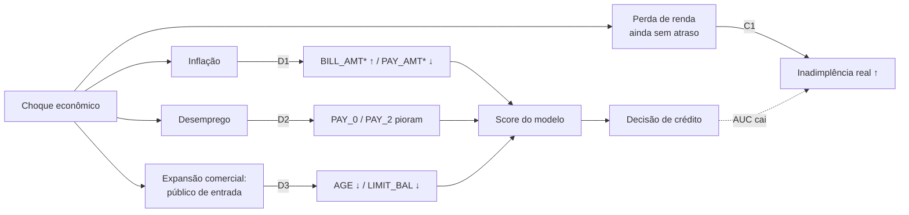

# FIAP MLET — Tech Challenge Fase 4

Observabilidade contínua, detecção de drift, qualidade de dados e governança para um
modelo de **credit scoring** em produção.

O problema: uma fintech tem um modelo de risco de crédito rodando, a economia muda e o
modelo degrada **em silêncio**. Este repositório constrói a camada de sustentação e
confiabilidade — contrato de dados, baseline rastreável, simulação/detecção de drift,
monitoramento e documentação de compliance (LGPD).

- Dataset: [UCI — Default of Credit Card Clients](https://archive.ics.uci.edu/dataset/350/default+of+credit+card+clients) (30.000 clientes, 25 colunas, alvo binário `default payment next month`).
- Tracking + storage: [DagsHub](https://dagshub.com/JosueJNLui/fiap-mlet-challenge-fase-4) (MLflow + DVC).

## Sumário

- [Arquitetura](#arquitetura)
- [Setup](#setup)
- [Etapa 1 — Contrato de dados e baseline](#etapa-1--contrato-de-dados-e-baseline)
- [Etapa 2 — Simulação e detecção de drift](#etapa-2--simulação-e-detecção-de-drift)
- [Análise causal da degradação](#análise-causal-da-degradação)
- [Comandos](#comandos)
- [Governança e LGPD](#governança-e-lgpd)
- [Convenções de Git](#convenções-de-git)

## Arquitetura

```text
data/
  raw/         # dataset cru (UCI) versionado via DVC
  reference/   # referência congelada (24k) + holdout limpo (6k), via DVC
  bad_batch/   # lote sujo gerado sob demanda para a demo do contrato
models/        # baseline.pkl + baseline_metrics.json (derivados, fora do Git)
reports/       # evidências (HTML de drift, etc.) — versionadas de propósito
src/creditmon/
  config.py    # Settings (Pydantic) — paths, seed e credenciais
  schema.py    # contrato de dados (Pandera) — bloqueia a ingestão
  data.py      # carga, validação e congelamento de referência/holdout
  train.py     # baseline XGBoost + MLflow (log, registro e alias `production`)
  tracking.py  # configuração do MLflow no DagsHub
  simulation.py # lotes mensais de produção com data drift e concept drift
  drift.py     # PSI, KS e relatórios do Evidently
scripts/       # download do dataset, validação de lote, gates de Git
tests/         # pytest
```

Separação central: **referência** (usada no treino) vs. **produção** (onde o drift
ocorre, na Etapa 2). O contrato responde "este dado é válido?"; a detecção de drift
responde "esta distribuição mudou?". Dado de produção pode ser válido e ainda assim
sofrer drift — por isso o contrato é intencionalmente generoso nos limites e rígido
apenas no que é impossível.

## Setup

Pré-requisitos: [uv](https://docs.astral.sh/uv/) e Python 3.12/3.13.

```bash
make install                     # uv sync --all-groups
cp .env.example .env             # preencha DAGSHUB_USER e DAGSHUB_TOKEN
make validate-env                # checa Python, deps, .env e token
make install-hooks               # opcional: habilita os hooks de Git
```

Credenciais: crie um token em `https://dagshub.com/user/settings/tokens` e preencha
`.env` (que é gitignored):

```dotenv
DAGSHUB_USER=seu-usuario
DAGSHUB_TOKEN=seu-token
```

## Etapa 1 — Contrato de dados e baseline

**Modelo baseline.** XGBoost (`n_estimators=200`, `max_depth=4`, `learning_rate=0.1`,
`scale_pos_weight` corrigindo o desbalanceamento ~78/22), treinado na referência e
avaliado no holdout. Cada execução loga parâmetros e métricas no MLflow, registra o
modelo como `credit_scoring_baseline` e promove a versão mais recente para o alias
`production`.

**Contrato de dados.** `src/creditmon/schema.py` (Pandera) bloqueia a ingestão antes do
treino/predição. Regras rígidas:

| Regra | Coluna(s) |
| :-- | :-- |
| Sem nulos | todas |
| `ID` único e positivo | `ID` |
| Idade plausível | `AGE ∈ [18, 100]` |
| Domínios fechados | `SEX ∈ {1,2}`, `EDUCATION ∈ {0..6}`, `MARRIAGE ∈ {0..3}` |
| Alvo binário | `default payment next month ∈ {0,1}` |
| Limites de sanidade | `LIMIT_BAL ∈ [0, 2M]`, `BILL_AMT ∈ [-1M, 2M]`, `PAY_AMT ≥ 0`, `PAY_* ∈ [-2, 8]` |
| Schema estrito | nenhuma coluna extra além das 25 esperadas |

`BILL_AMT` pode ser negativo de propósito (saldo credor é um estado válido); o contrato
não barra valores economicamente possíveis, apenas impossíveis.

**Demonstração do bloqueio.** `scripts/create_bad_batch.py` injeta violações (nulo,
idade de menor, domínio inválido, alvo inválido, `ID` duplicado) e
`scripts/validate_batch.py` rejeita o lote com exit code `1`:

```bash
make demo-contract
```

## Etapa 2 — Simulação e detecção de drift

**Dataset de produção.** `src/creditmon/simulation.py` parte do **holdout** congelado
na Etapa 1 (dados que o modelo nunca viu) e o fatia em 6 lotes mensais
(`2026-01` → `2026-06`, 1.000 clientes cada) com um choque econômico de intensidade
crescente (0% → 100%). **Jan/2026 é o mês de controle, sem drift**, para provar que o
monitor não dispara falso positivo.

| Mecanismo | Tipo | O que muda (intensidade 100%) |
| :-- | :-- | :-- |
| D1 Inflação | data drift | `BILL_AMT*` +60%; `PAY_AMT*` −40% (renda real comprimida) |
| D2 Desemprego | data drift | 30% dos clientes pioram 1–2 níveis em `PAY_0`/`PAY_2` |
| D3 Novo perfil | data drift | 55% dos clientes 8–15 anos mais jovens, com limite 40% menor |
| C1 Inadimplência silenciosa | **concept drift** | clientes com histórico limpo passam a inadimplir com +12% de probabilidade: perderam renda, mas o atraso ainda não aparece nas features |

Os valores simulados respeitam os limites do contrato: **todo lote com drift passa no
`schema.py`**. Drift não é dado inválido, e por isso o contrato sozinho não protege o
modelo.

**Predições.** `src/creditmon/drift.py` escora cada lote de produção com o baseline e
grava as predições (probabilidade de default e decisão por cliente) em
`data/processed/production/predictions_<mes>.csv`. O relatório mostra, por mês, o score
médio e a taxa de aprovação.

**Detecção.** Cada lote escorado é comparado com a referência usando dois métodos
independentes:

- **PSI** (Population Stability Index): *quanto* a distribuição mudou (decis da
  referência para contínuas, categorias para discretas);
- **Kolmogorov-Smirnov**: *se* a mudança é estatisticamente significativa.

Uma feature tem drift quando **PSI ≥ 0,25**, ou quando **PSI ≥ 0,10 e p-valor KS
< 0,05**. Exigir as duas evidências evita o falso positivo do KS em lotes grandes.
Também medimos o **prediction drift** (PSI do score) e a performance do modelo quando
o rótulo da safra chega (ROC AUC, KS de separação, recall, taxa de aprovação).

O **Evidently AI** roda em paralelo (`DataDriftPreset` com PSI + `ClassificationPreset`).
O PSI dele é gravado ao lado do nosso, como validação cruzada da implementação.

```bash
make simulate   # data/processed/production/production_<mes>.csv
make drift      # predições + reports/drift/
```

| Entregável | Arquivo |
| :-- | :-- |
| Relatório consolidado (variáveis degradadas por mês) | `reports/drift/drift_report.md` |
| HTML do Evidently: mês de controle e último mês | `reports/drift/evidently_2026-01.html`, `evidently_2026-06.html` |
| Tabela estatística por feature (PSI, PSI Evidently, KS, médias) | `reports/drift/feature_drift_<mes>.csv` |
| Resumo para os próximos estágios | `reports/drift/drift_summary.json` |

## Análise causal da degradação

Como o cenário de produção é simulado, a causa da queda do modelo pode ser medida por
**intervenção**, não só inferida. `src/creditmon/causal.py` (`make causal`) roda uma
ablação sobre o holdout inteiro (6.000 clientes, choque de intensidade 100%, mesma seed e
mesmos sorteios aleatórios em todos os cenários): cada mecanismo **isolado** e o choque
completo com cada mecanismo **removido**. Resultados em `reports/causal/causal_report.md`.



| Cenário | Drift share | PSI do score | ROC AUC | Δ AUC | AUC recuperada ao remover |
| :-- | --: | --: | --: | --: | --: |
| Sem choque | 0% | 0,002 | 0,780 | | |
| Choque completo | 67% | 0,087 | 0,642 | −0,138 | |
| Só D1 inflação | 48% | 0,078 | 0,772 | −0,008 | 5% |
| Só D2 desemprego | 10% | 0,071 | 0,742 | −0,038 | 14% |
| Só D3 novo perfil | 10% | 0,021 | 0,762 | −0,018 | 7% |
| Só C1 inadimplência silenciosa | **0%** | **0,002** | **0,678** | **−0,102** | **54%** |

**Leitura.**

- **A causa principal da queda de AUC é o concept drift (C1), e ele é invisível para o
  monitor de data drift.** Sozinho, C1 responde por 74% da queda (−0,102 de −0,138) com
  drift share 0% e PSI do score 0,002: as features e o score não mudam, só a relação entre
  eles e a inadimplência. É a degradação silenciosa do enunciado.
- **O drift mais visível é o menos danoso.** A inflação (D1) move 48% das features, mas
  custa só 0,008 de AUC: faturas e pagamentos sobem e descem para todos, e o ranking de
  risco se mantém.
- **D2 e D3 são data drift que também quebram P(y|X).** O desemprego piora `PAY_0`
  (a feature mais forte do modelo) sem que esses clientes inadimplam mais na simulação, e o
  novo perfil muda idade e limite sem mudar o risco. Por isso tiram AUC mesmo sem rótulo
  novo.
- **Por que o PSI do score fica moderado (0,121 nos lotes mensais de jun).** Os
  mecanismos se compensam: D2 empurra o score para cima (aprovação 59,6% no cenário
  isolado) e D3 para baixo (73,9%). Removendo D3, o PSI do score sobe para 0,194. Um
  monitor só de score subestima o choque.
- **Os efeitos não são aditivos:** a soma das quedas isoladas (−0,166) passa da queda do
  choque completo (−0,138), porque os mecanismos atingem os mesmos clientes.
- **Maio abaixo de junho nos lotes mensais (AUC 0,607 vs. 0,640) é amostra, não
  mecanismo.** Na dose-resposta sobre o holdout inteiro a AUC cai de forma monotônica
  (0,780 → 0,742 → 0,711 → 0,684 → 0,661 → 0,642). Um lote de 1.000 clientes tem IC 95%
  de cerca de ±0,035 na AUC; o lote de maio fica abaixo do intervalo esperado
  (0,624 a 0,693), efeito dos clientes e sorteios daquele lote.
- O drift share de 67% aqui é maior que os 52% do lote de jun porque, com 6.000 clientes,
  o KS tem mais poder para confirmar mudanças moderadas.

**Prescrição.**

1. **Monitorar performance por safra, não só distribuição.** O PSI das features e do
   score não detecta C1. Quando o rótulo da safra amadurece, a queda de AUC vs. baseline
   (alerta `auc_drop`, limiar 0,05) é o sinal decisivo; até lá, acompanhar a
   inadimplência precoce (primeiras faturas em atraso) como proxy.
2. **Retreinar com a safra recente quando o rótulo chegar**, disparado pelo alerta de AUC
   ou por dataset drift persistente; validar o novo modelo contra o holdout e a safra
   recente antes de trocar o alias `production`.
3. **Não reagir só ao volume de drift.** D1 gera o maior drift share com o menor dano:
   um gatilho de retreino baseado apenas em drift share retreinaria pelo motivo errado.
4. **Revisar a política com o negócio para o público novo (D3)**, que também cria
   disparidade de aprovação por idade (ver Governança e LGPD).

## Comandos

```bash
make help            # lista todos os alvos
make install         # instala as dependências
make data-download   # baixa o dataset da UCI e converte para CSV
make reference       # congela data/reference/ (referência + holdout)
make train           # treina o baseline e loga no MLflow/DagsHub
make bad-batch       # gera o lote sujo da demo
make demo-contract   # demonstra o contrato aceitando o limpo e bloqueando o sujo
make simulate        # gera os lotes mensais de produção com drift
make drift           # detecta drift e gera os relatórios (PSI, KS, Evidently)
make fairness        # auditoria de equidade por grupo e comparação de variantes
make causal          # ablação dos mecanismos de drift (análise causal)
make validate        # lint + testes + gates de branch/commit/tag
make test            # pytest
make lint            # ruff
make check           # lint + test
```

Fluxo completo do zero:

```bash
make install && make data-download && make reference && make train && make demo-contract
make simulate && make fairness && make drift && make causal
```

## Governança e LGPD

Plano de proteção de dados do projeto (detalhamento na Etapa 4):

- **Dados e PII.** O dataset é público e **anonimizado pela UCI**: sem nome, CPF,
  endereço ou qualquer identificador direto. O campo `ID` é um índice sintético do
  arquivo, não uma identidade. Ainda assim é tratado como identificador (não é
  feature do modelo) e nunca é exposto em relatórios.
- **Base legal.** A decisão de crédito se apoia em *legítimo interesse* e *execução de
  contrato* (LGPD, art. 7º, V e IX), com o titular ciente do processo de análise.
- **Minimização.** Só entram no modelo 21 features; `ID`, o alvo, `SEX` e `MARRIAGE`
  ficam fora das features. Nenhum dado sensível é inferido ou criado.
- **Retenção.** Dados de referência e lotes de produção ficam versionados via DVC no
  DagsHub e são reprocessáveis; logs de experimento no MLflow guardam métricas e
  parâmetros, não o dado bruto.
- **Vieses.** `make fairness` mede aprovação, recall e FPR por `SEX`, `EDUCATION`,
  `MARRIAGE` e faixa de `AGE`, e compara variantes do baseline
  (`reports/fairness/fairness_report.md`). Retirar `SEX` e `MARRIAGE` não custou ROC AUC
  (0,7798 → 0,7804 no holdout) e elevou a razão de aprovação feminino/masculino em
  jun/2026 de 0,906 para 0,989, então o baseline em produção não usa essas variáveis.
  `make drift` acompanha a razão de aprovação por mês e alerta quando um atributo que
  cumpria a regra dos 4/5 no holdout deixa de cumprir (faixa de `AGE` a partir de
  mar/2026, efeito do novo perfil jovem).
- **Direito do titular.** O contrato de dados e a separação referência/produção
  permitem reconstruir e auditar o que influenciou cada decisão.

## Convenções de Git

O repositório aplica gates automatizados (CI + hooks opcionais):

- **Branches** — Conventional Branch 1.0.0: `feat/`, `fix/`, `chore/`, `release/…`.
- **Commits** — Conventional Commits 1.0.0: `feat:`, `fix(scope):`, `docs:`, etc.
- **Tags** — SemVer estrito `MAJOR.MINOR.PATCH`.

```bash
make validate          # roda todos os gates
make install-hooks     # ativa as validações no pre-commit/commit-msg/pre-push
```

## Roadmap

- [x] **Etapa 1** — contrato de dados + baseline treinado.
- [x] **Etapa 2** — simulação e detecção de drift (Evidently AI, PSI/KS).
- [ ] **Etapa 3** — observabilidade de pipeline e modelo (MLflow/DagsHub, métricas).
- [ ] **Etapa 4** — governança (LGPD), análise causal e vídeo STAR.
